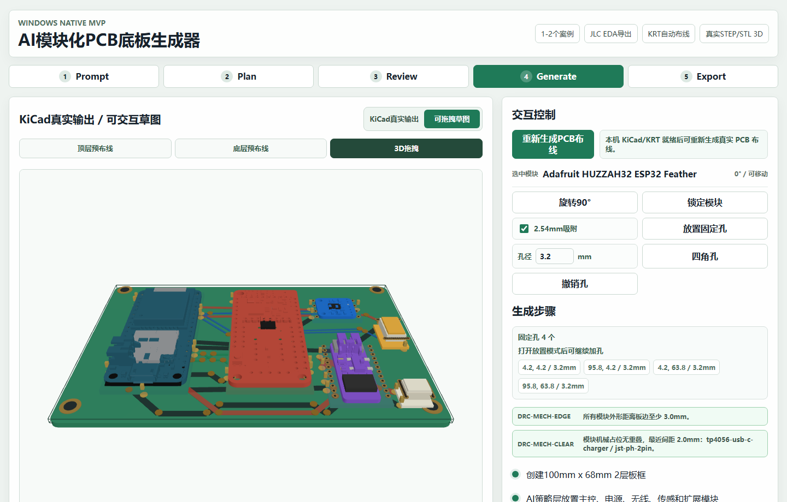
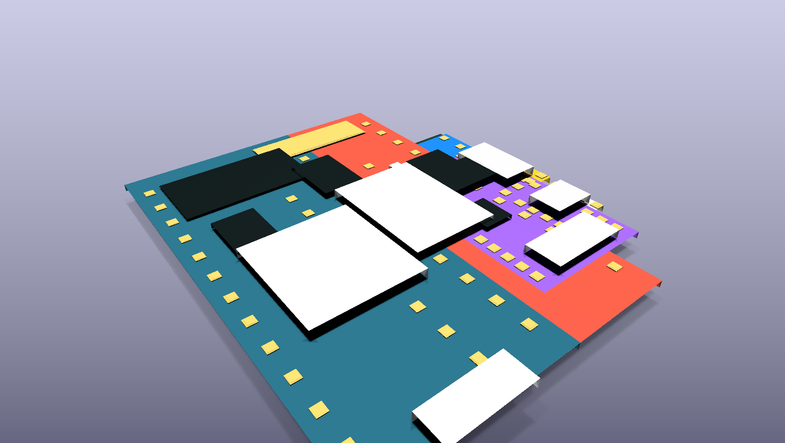

# Blockless PCB Studio

Turn a product brief into a modular PCB backplane concept, then inspect the module plan, placement, routing, enclosure, BOM, checks, and manufacturing-oriented outputs in one workspace.

[Apache-2.0 licensed](LICENSE) · English UI by default · Chinese UI included



## What it does

Blockless PCB Studio is a browser-based prototype for building products from reviewed commercial modules instead of redesigning every circuit from scratch.

The browser workspace can:

- match a natural-language brief to one of 13 curated product cases;
- select compatible ESP32, sensor, radio, power, display, storage, and connector modules;
- generate deterministic placement constraints, keepouts, nets, and an editable routing sketch;
- preview the board and a generated enclosure in 2D and 3D;
- export a BOM, review report, module-asset manifest, OpenSCAD enclosure, and a structured JLC EDA-oriented ZIP;
- display cached KiCad/KiCadRoutingTools outputs and CAM/CNC previews.

The optional KiCad host flow goes further: it creates real `.kicad_pcb` files, routes copper with KiCadRoutingTools, runs KiCad DRC, exports layer SVGs, renders the board, and can generate pcb2gcode CNC toolpaths.



## Important scope boundary

This repository is an MVP, not a general-purpose or fabrication-ready AI PCB designer.

- The current browser planner does not call an LLM. It scores the prompt against 13 curated cases and applies deterministic module, placement, and routing rules.
- The interactive browser routes are design sketches. The KiCad host flow is the source of real copper geometry.
- The JLC EDA export is a structured demo subset, not a native production project.
- The checked-in `*-krt-drc.rpt` reports show 0 DRC violations and 0 unconnected pads for the two routed demos. The pre-routing reports intentionally show unresolved connectivity, and several checks in the routed reports are excluded. Always review the board, footprints, rules, and manufacturing outputs before fabrication.

## Quick start

Requirements:

- Node.js 22 or newer
- npm 10 or newer

```powershell
git clone https://github.com/FreakStudioCN/blockless-pcb-studio.git
cd blockless-pcb-studio
npm ci
npm run dev -- --port 5173
```

Open <http://127.0.0.1:5173>.

### Docker Desktop

For a browser-only demo on Windows or macOS:

```powershell
docker compose up --build
```

Open <http://127.0.0.1:5173>. Native KiCad and CAM actions are disabled in the container.

The real CAD assets and generated demo outputs needed by the UI are already cached in the repository. To refresh public module assets from their upstream sources:

```powershell
npm run harvest:assets
```

## How it works

```text
Product brief
    -> curated case matching
    -> commercial module selection
    -> interface and net matching
    -> constraint-based placement
    -> interactive A* routing sketch
    -> BOM / checks / enclosure / export

Optional native host flow
    -> plan JSON
    -> KiCad board synthesis
    -> KiCadRoutingTools autorouting
    -> KiCad DRC / SVG / 3D render
    -> pcb2gcode CAM output
```

The AI boundary is deliberately narrow: language models can propose module choices and constraints, while deterministic tools own geometry, routing, and verification.

## Demo cases

The browser contains 13 curated briefs. Two have complete checked-in KiCad host outputs:

- Long-range battery-powered environmental node: ESP32, LoRa, BME280/SHT31, LiPo charging, battery connector, and I2C expansion.
- Desktop air-quality monitor: ESP32, SGP30, BME280, OLED, USB-C power, and I2C expansion.

## KiCad host flow

The host scripts support KiCad 10 on Windows and macOS. macOS support covers board generation, KiCadRoutingTools, DRC, rendering, and SVG export; CNC export remains Windows-only. See [`kicad-host-mvp/README.md`](kicad-host-mvp/README.md) for setup details.

Check that KiCad was detected, then download the pinned optional autorouter and its dependencies into ignored local directories:

```powershell
npm run kicad:check
npm run kicad:setup-router
```

```powershell
npm run kicad:plans
npm run kicad:validate
npm run kicad:build
npm run kicad:ai-route
```

Check the local installation first:

```powershell
powershell -ExecutionPolicy Bypass -File .\kicad-host-mvp\scripts\check_kicad.ps1
```

## Verification

The default checks do not require KiCad:

```powershell
npm run build
npm run kicad:validate
npm run test:ui
```

To include the real KiCad + pcb2gcode action in the desktop end-to-end test:

```powershell
$env:RUN_KICAD_INTEGRATION = "1"
npm run test:ui
```

## Repository map

```text
src/                    React workspace and deterministic planning engine
public/assets/          Cached CAD, screenshots, KiCad SVGs, and CAM previews
kicad-host-mvp/         KiCad plugin, plans, scripts, routed boards, and reports
tools/                  Optional local KiCadRoutingTools checkout and dependencies (ignored)
tests/                  Desktop and mobile Playwright flow
docs/media/             README and release media
```

## Known limitations

- Only the two primary demo cases have a complete checked-in KiCad host pipeline.
- Native KiCad automation is exercised locally on Windows. The cross-platform entry point and Web app run in macOS CI, but the full KiCad GUI/render pipeline still needs confirmation on a physical Mac.
- The production JavaScript bundle is about 946 kB before gzip; Three.js and export code should eventually be split into lazy-loaded chunks.
- Module metadata, pin maps, purchase links, and CAD provenance need continued human review as the registry grows.

## License and third-party work

Blockless PCB Studio is licensed under the [Apache License 2.0](LICENSE). Bundled Adafruit CAD assets and the optional KiCadRoutingTools dependency remain under their MIT licenses; see [THIRD_PARTY_NOTICES.md](THIRD_PARTY_NOTICES.md).

## Safety

Do not send generated boards or CNC toolpaths directly to fabrication or a machine. Review electrical rules, footprints, clearances, stack-up, tool diameters, feeds, speeds, workholding, and machine limits first.
